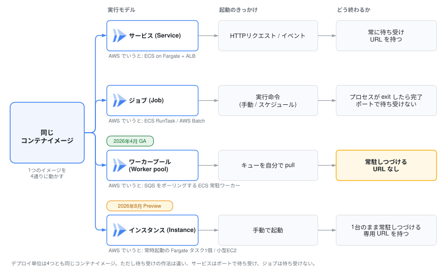

# 2. Cloud Runとは

**Cloud Run** は「コンテナを渡すと、HTTPS の URL を返してくれる」フルマネージドなコンテナ実行基盤です。

- サーバー(VM・クラスタ)の管理は不要
- リクエストに応じて **0台から自動でスケール**し、使った分だけ課金
- デプロイはコンテナイメージを指定して行う

## 1. 「4つの実行モデル」

Cloud Run には現在、ワークロードの形に合わせた**4つの実行モデル**があります。  
今日のハンズオンの主役は Service ですが、この4分類を頭に入れておくと「Cloud Run は HTTP リクエストを受けるだけのもの」という思い込みをせずに済みます。

| 実行モデル | 向いているもの | AWSでいうと |
|---|---|---|
| **[Service](https://cloud.google.com/run/docs/overview/what-is-cloud-run#cloud_run_services)** | HTTPリクエスト / イベント駆動 | ECS on Fargate + ALB(1コマンドで立てるなら ECS Express Mode), Lambda + ALB |
| **[Job](https://cloud.google.com/run/docs/overview/what-is-cloud-run#cloud-run-jobs)** | 実行して終わるバッチ処理 | ECS RunTask, AWS Batch |
| **[Worker pool](https://cloud.google.com/run/docs/overview/what-is-cloud-run#cloud-run-worker-pools)** | 常駐してキューをpullし続ける処理。Pub/Sub の pull 型ワーカーのような「リクエスト起点でない常駐処理」 | SQSをポーリングするECS常駐ワーカー |
| **[Instance](https://cloud.google.com/run/docs/overview/what-is-cloud-run#cloud-run-instances)** | 1台であることに意味があるシングルトン常駐(2026年10月時点で Preview) | 常時起動の Fargate タスク1個 / 小型EC2 |

同じイメージ・同じ開発体験のまま実行モデルだけ選び替えられるのが、Cloud Runの設計の一貫性です。

選び分けの軸は3つだけです。

1. リクエストが来る場合
  - Service
    - Webサービス向け
2. 処理に終わりがあるか
  - Job, Worker pool
    - タスク処理
3. コンテナインスタンスが1台か
  - Instance
    - botやAIエージェントなど状態を持つもの
    - 固有のURL・SSH接続・Cloud Storageにも対応

<!--
> **[要作図] 図2: 実行モデル**
>
> - **目的:** 「Cloud Run は HTTP リクエストを受ける Service だけ」という思い込みを壊す。**同じコンテナイメージが中央にあり、そこから4方向に分岐する**という構図にすることが要点
> - **中央:** 「同じコンテナイメージ」の箱を1つ置く
> - **4方向の分岐:** それぞれ「何が起動のきっかけか」→「どう終わるか」を1組で描く
>   - Service: HTTPリクエスト / イベント → 常に待ち受け(URLを持つ)
>   - Job: 実行命令(手動 / スケジュール) → プロセスが exit したら完了
>   - Worker pool: キューを自分で pull → 常駐しつづける(URLを持たない、N台に分散する)
>   - Instance: 手動で起動 → 1台のまま常駐しつづける(専用URLを持つ、Preview)
> - **補足:** Worker pool に「URLなし」を明示すると、Service との違いが伝わる。Worker pool と Instance は「N台か1台か」で対比させると境目が伝わる。AWS 対応(ECS on Fargate + ALB / ECS RunTask / SQSをポーリングするECS常駐ワーカー / 常時起動の Fargate タスク1個)を各分岐の脇に小さく添えてもよい
> - **完成後の扱い:** `02_cloudrun/imgs/three-execution-models.svg` として保存し、**見出しの直下**に `` として差し込む(見出し → 画像 → 本文の順。キャプション文は付けない)
> - **現在の状態:** 上に差し込まれているのは draw.io で作図した完成図です。4分岐(Service / Job / Worker pool / Instance)をすべて描いています。SVG に編集元の XML を埋め込んであるため、**このファイルをそのまま draw.io で開いて編集できます**
-->

## 2. Cloud Run Service

このハンズオンでは、4つの実行モデルのうち **Cloud Run Service** を中心に扱います。  
Cloud Run Serviceを学習するにあたり、まずは以下の3つの要素を押さえると良いでしょう。

1. **Service**
    - URL を持つ論理単位。ECS でいう「サービス+ALB+ターゲットグループ」を1つにしたもの
2. **リビジョン**
    - デプロイのたびに作られる**不変のスナップショット**(イメージ+環境変数+CPU/メモリ設定のセット)
    - 過去のリビジョンは残り続けるため、ロールバックなどが容易
3. **トラフィック分割**
    - どのリビジョンに何%流すかを制御
    - ロールバックもカナリアもこの仕組みの上に乗っている

> **「リビジョンが不変で、トラフィックを好きに振り分けられる」**  
> Docker のイメージと同じ**「不変のスナップショットを積み重ねる」**という考え方が、プラットフォームの機能にまで貫かれています(後述の章で実際に手を動かしながら体感します)。  
> ここが Cloud Run の設計の美しさでもあります。

## 3. 料金

課金モデルは2種類から選びます(Service 作成後も切替可)。

- **request-based billing(デフォルト)**: リクエスト処理中を中心に CPU・メモリが課金され、スケールtoゼロ時はインスタンス課金がなくなる。起動・終了処理や min-instances のアイドル時間など例外はある
- **instance-based billing**: インスタンス起動中は常時課金。単価はrequest-basedより安く、常時処理があるワークロード向け

無料枠も課金モデルごとにあります(2026年10月時点。単価・無料枠は改定されるので[公式の料金ページ](https://cloud.google.com/run/pricing)が正)。

- request-based: 月あたり vCPU 18万秒 / メモリ 36万GiB秒 / リクエスト200万件
- instance-based: 月あたり vCPU 24万秒 / メモリ 45万GiB秒

個人開発や社内ツールなら実質無料で運用できることが多く、「とりあえず公開しておく」が気軽にできます。

## 4. AWSでいうと何?

Fargate・Lambda（・App Runnner） などのどれかに対応付けたくなりますが、どれとも微妙に違います。  
この「微妙に違う」がそのまま Cloud Run の魅力なので、表で整理してみましょう(2026年10月時点)。

| | Lambda(標準) | ECS on Fargate + ALB | **Cloud Run** |
|---|---|---|---|---|
| デプロイ単位 | イメージ / ソース | イメージ | イメージ / ソース |
| 実行モデル | 1リクエスト=1実行環境 ※1 | 常駐 | **1インスタンスで複数リクエストを並行処理**(既定80・最大1000) |
| スケールtoゼロ | ○ | × | **○** |
| 課金 | リクエスト処理時間 | 常時(起動時間) | **リクエスト単位 / 常時 を選択可** |
| 実行時間上限 | 15分 | なし | 60分(リクエストあたり) |
| HTTPS URL | ○ (Function URLs機能) | 要 ALB + ACM | **○(自動発行)** |
| WebSocket / gRPC / HTTP2 | △ (要別サービス) | ○(要ALB/NLB設定)| **○** |
| VPC | **外(接続可)** | 内で動く | **外(接続可)** |

> ※1 2025年11月に登場した **Lambda Managed Instances** では、1つの実行環境で複数リクエストの並行処理が可能になりました。「普通のWebサーバー+インスタンス内並行処理」という Cloud Run が以前から持つモデルと近づいてきたと考えると両クラウドの設計思想の変化が見えて面白いところです。  

押さえておきたいポイントは3つです。

1. **手軽さとコンテナの自由度。** 
  - スケールtoゼロ・従量課金でありながら、中身はただのWebサーバー。
  - Lambda 特有のハンドラ関数やランタイム制約がなく、手元で `docker run` できるものがそのまま動きます。
2. **1インスタンスが複数リクエストを同時に捌く。** 
  - 標準の Lambda は1リクエスト1環境なのでインスタンス数が爆発しがちですが、Cloud Run は「並行数(concurrency)」の分だけ1台で受けます。Webサーバーの常識がそのまま通用します。
3. **VPCが前提にない。** 
  - AWS では最初に VPC を作りますが、Cloud Run はデフォルトで VPC の外。
  - VPC内のリソースへ接続が必要になったときだけ VPC に「つなぎに行く」発想です。

## まとめ

- Cloud Run = コンテナを渡すと HTTPS URL が返ってくる。Lambda の運用感覚 × コンテナの自由度
- 実行モデルは「Service・Job・Worker pool・Instance」の4つ(Instance は Preview)。今日の主役は Service で、概念は「Service・リビジョン・トラフィック分割」の3つだけ。**AWS 側で ECS・ELB・CloudWatch・IAM・Application Auto Scaling に散っていた設定が、この3つと数個のつまみに集まっている**
- 座学はここまで。**ここからは全部手を動かします**
