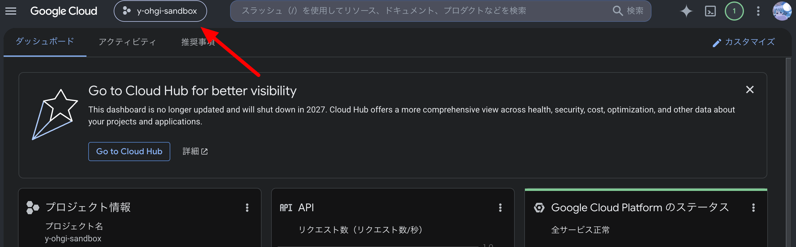
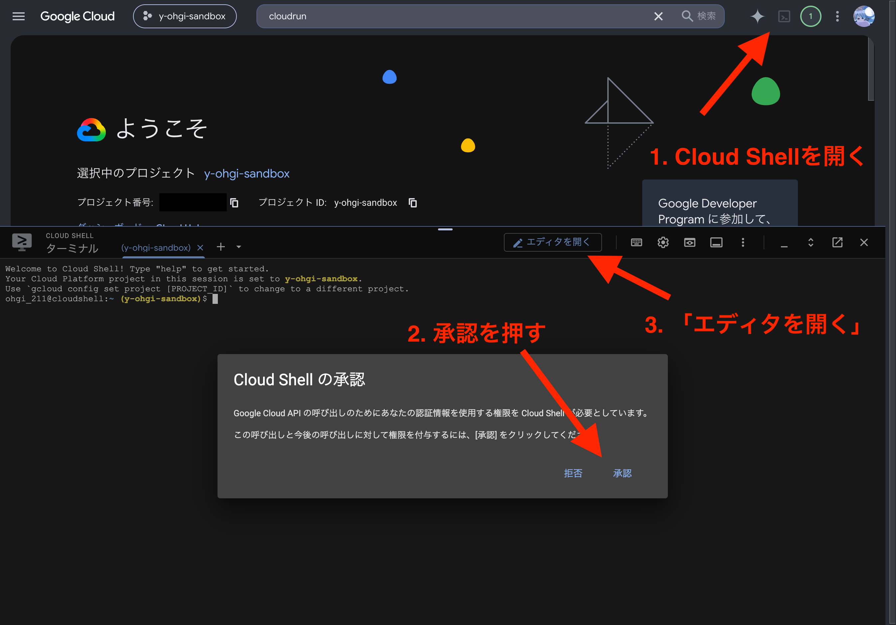
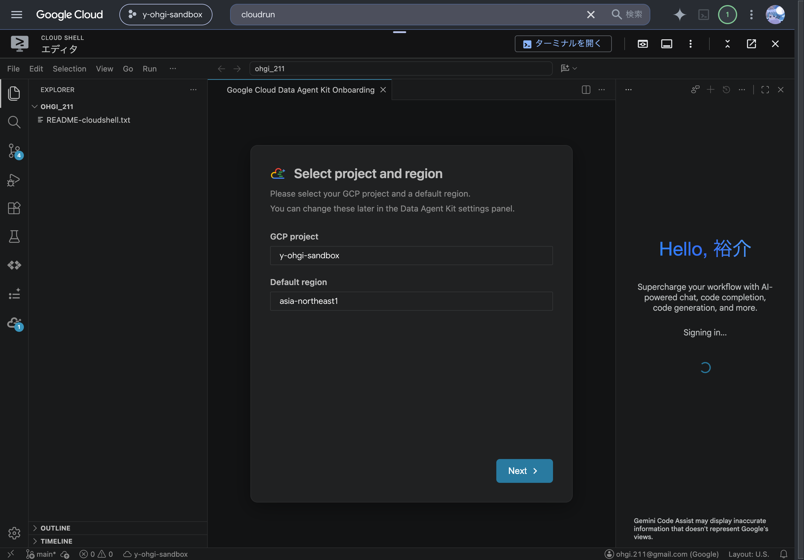
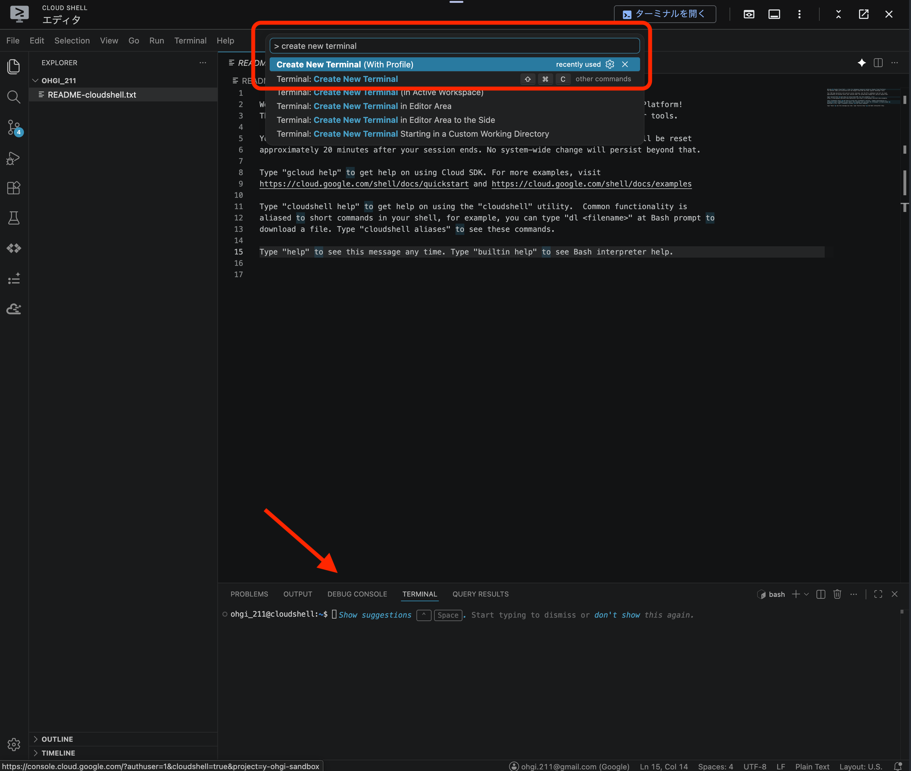

# 3. Google Cloudのセットアップ

Google Cloud のプロジェクトを作り、今日使う分だけAPIを有効化して、サンプルコードを手元に用意します。  
ここから先はブラウザ(Google Cloud コンソールと Cloud Shell)だけで進みます。

## 1. Google Cloud プロジェクトを作る

1. [Google Cloud コンソール](https://console.cloud.google.com/)にログイン
2. 初めての場合は無料トライアル(90日 / $300 クレジット)の案内に従う
3. 画面上部のプロジェクトセレクタから「新しいプロジェクト」を作成
  - プロジェクト名: `sandbox` など(IDは自動でユニークになります)
4. 課金が有効になっていることを確認([課金ページ](https://console.cloud.google.com/billing))
  - クレジットカードの登録が必要です。

**このハンズオンではハンズオン専用プロジェクトを推奨します。**  
ハンズオン後にプロジェクトごと削除すれば、消し忘れによる課金の心配がありません。

別のプロジェクトが選ばれたまま進むと、この先のコマンドがすべて無関係なプロジェクトに対して実行されてしまいます。  
画面上部のプロジェクトセレクタで、今作ったプロジェクトが選ばれていることを確認してください。



## 2. Cloud Shellを開く

[shell.cloud.google.com](https://shell.cloud.google.com/) を開くか、コンソール右上のターミナルアイコンから Cloud Shell を起動し、「エディタを開く」をクリックします。



Cloud Shell は Google Cloud が無料で使える開発環境で、AWS の CloudShell に相当します。  

## 3. Cloud Shell エディタを開く
Cloud Shellからエディタを開くと、VSCodeベースのエディタが使用可能です。  
ファイルの編集・保存がそのままブラウザで完結します。  
ハンズオンではこのエディタを使用して進めていきます。

初回起動時にプロジェクトとリージョンを聞かれます。  
今回使用するプロジェクトと、デフォルトリージョンを `asia-northeast1` (東京リージョン)を選択します。


順調に進むとエディタが使用可能になります。  
VSCodeを普段から使っている方なら直感的に使用可能だと思います。  
今回欲しいのはエディタとTerminalなので、Terminalの起動も行います。  
以下のように、コマンドパレットから `> create new terminal` と入力するとTerminalが画面下部に出力されます。


### Docker
`docker` CLI が最初からインストールされています。  
イメージのビルドと実行がその場でできます。今回のハンズオンの鍵です。

### `gcloud` CLI
ログイン済みの状態で使えます。認証設定は不要です。

### 5GB の永続ホームディレクトリ
永続するのは `$HOME` だけです。それ以外への変更はセッション終了で失われます。

> **Cloud Shell を普段からよく使っている人へ**  
> 週あたりの利用時間クォータ(デフォルト50時間)があり、使い切るとリセット時刻まで一切使えません。  


## 4. 動作確認

```bash
gcloud config get-value project
docker version
```

プロジェクトIDが表示され、`docker version` がエラーにならなければ準備完了です。

`(unset)` と表示された場合や、作った覚えのないプロジェクトIDが表示された場合は、`gcloud` に今日使うプロジェクトが設定されていません。次のコマンドでプロジェクトを設定してから、もう一度 `gcloud config get-value project` を実行してください。

```bash
gcloud config set project <プロジェクトID>
```

## 5. 動作確認

```bash
gcloud config get-value project
docker version
```

プロジェクトIDが表示され、`docker version` がエラーにならなければ準備完了です。

`(unset)` と表示された場合や、作った覚えのないプロジェクトIDが表示された場合は、`gcloud` に今日使うプロジェクトが設定されていません。次のコマンドでプロジェクトを設定してから、もう一度 `gcloud config get-value project` を実行してください。

```bash
gcloud config set project <プロジェクトID>
```

プロジェクトIDはコンソール上部のプロジェクトセレクタで確認できます。  
「1. Google Cloud プロジェクトを作る」で付けたプロジェクト名とは別に、`sandbox-123456` のように自動採番されたIDです。

### 覚えておくと速いショートカット
必須ではありませんが、知っておくと操作が速くなります。

| 操作 | ショートカット |
|---|---|
| コマンドパレットを開く | `Cmd+Shift+P` / `Ctrl+Shift+P` |
| ファイルを名前で開く | `Cmd+P` / `Ctrl+P` |
| ファイル内を検索 | `Cmd+F` / `Ctrl+F` |
| プロジェクト全体を検索 | `Cmd+Shift+F` / `Ctrl+Shift+F` |

このハンズオンの基本サイクルは、ここからずっとこの繰り返しになります。

1. エディタでファイルを編集する
2. 保存する(`Cmd+S` / `Ctrl+S`)
3. ターミナルでコマンドを実行する(`docker build`、`gcloud run deploy` など)
4. 結果をブラウザやターミナルの出力で確認する

## 6. APIを有効化する

起動したTerminalから、今日使うAPIをまとめて有効化します。  
数分かかることがあるので先に有効化を行います。

```bash
gcloud services enable \
  run.googleapis.com \
  artifactregistry.googleapis.com \
  cloudbuild.googleapis.com
```

1. run.googleapis.com
  - Cloud Runの有効化
2. artifactregistry.googleapis.com
  - ArtifactRegistryの有効化
    - コンテナレジストリです。
3. cloudbuild.googleapis.com
  - CloudBuild、(CI/)CDのためのサービスです。

### AWSとの違い
Google Cloud では各サービスの API を明示的に有効化してから使います。  
AWS のようにすべてのサービスが最初から呼べる状態ではなく、プロジェクトごとに使うサービスをオプトイン(/オプトアウト)する思想です。

## まとめ

- Cloud Shell / Cloud Shell エディタの有効化をした。
- Google Cloud のプロジェクトを作成し、今日使うAPIを有効化した。
- ここから先はこのCloud Shell エディタを利用してハンズオンを進めていきます。
