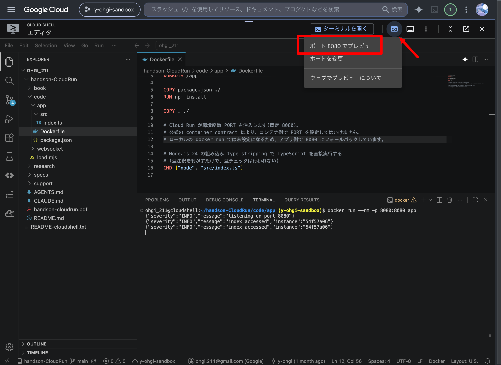
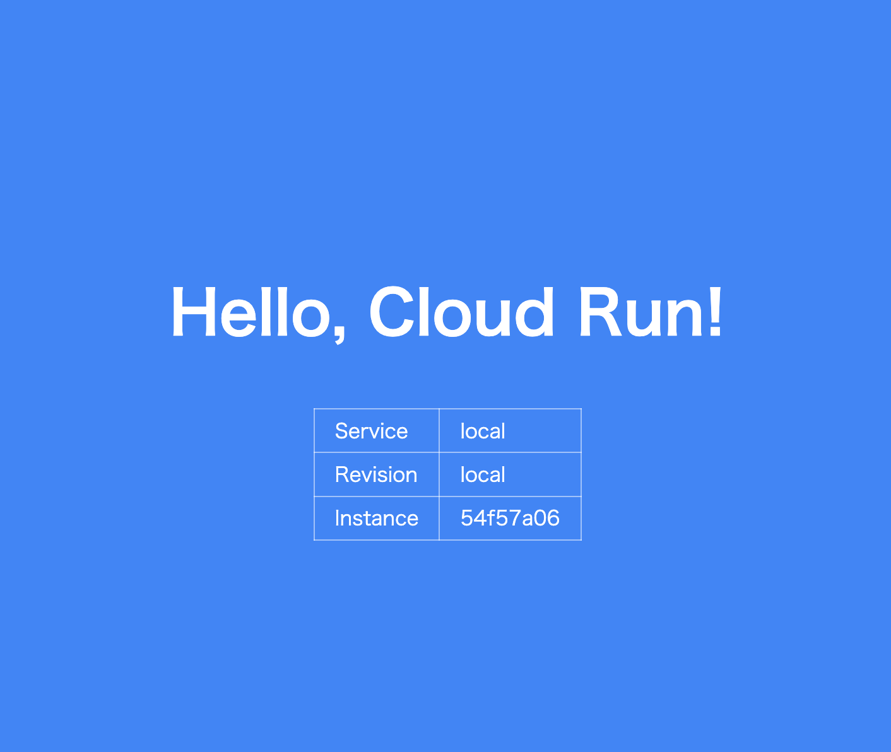

# 4. Dockerのおさらいとコンテナ起動

この章では Cloud Shell エディタとターミナルを行き来しながら、Docker の要点をおさらいし、実際に Web サーバーのコンテナイメージを作って・動かして・ブラウザで見るところまでやってみましょう。  

> Docker をしっかり学びたい人は [introduction-docker](https://github.com/y-ohgi/introduction-docker) にまとまっています。今日は Cloud Run に必要な分だけ、駆け足で。

## 1. Dockerのおさらい: 3つの登場人物

| 用語 | 一言でいうと |
|---|---|
| **Dockerfile** | イメージの設計図(テキストファイル) | 
| **イメージ** | アプリ+依存関係+OSライブラリを固めたスナップショット |
| **コンテナ** | イメージを実行したプロセス |

ポイントは1つだけです: **イメージは不変(immutable)**。  
「環境ごと固めて配る」からこそ、ローカルでも Cloud Run でも ECS でも同じように動きます。  
この不変性が、ロールバックやカナリアリリースの土台になります。

## 2. サンプルコードを手元に用意する

今日使うサンプルコードをこのリポジトリから取得します。  

```bash
cd ~
git clone https://github.com/y-ohgi/introduction-CloudRun.git
cd introduction-CloudRun/code/app
$ ls -a
# .  ..  Dockerfile  .dockerignore  package.json  src
```

アプリは TypeScript + [Hono](https://hono.dev/) で書かれています。  
Hono は Web 標準 API ベースの軽量な Web フレームワークです(Hono 自体は Cloudflare Workers や Deno などマルチランタイム対応ですが、今回は Node.js アダプタと Node.js API を使います)。  
実行には Node.js 24 の組み込み **type stripping** (型注釈を剥がして実行する機能)を使い、この教材で使う範囲の TypeScript をビルドステップなしで動かします。  
ビルドを1段消すことで、今日の主役である Cloud Run に集中するためです。

やり直すときは、cloneしたリポジトリを削除し、再度cloneすることで初期状態から再開できます。

## 3. Webサーバーを公開する

### イメージをビルドする

```bash
docker build -t handson-app:v1 .
```

手元に Node.js がなくても(`npm install` を一度も打っていなくても)ビルドできることに注目してみましょう。  
依存解決も実行環境も、すべてイメージの中で完結しています。  
`docker images` で `handson-app` ができていることを確認してみましょう。

### コンテナを起動する

```bash
docker run --rm -p 8080:8080 handson-app:v1
```

### ブラウザで見る

Cloud Shell の右上にある[ウェブでプレビュー]ボタン(ウィンドウの中に目が描かれたアイコン)→[ポート 8080 でプレビュー]をクリックします。



青い画面に「Hello, Cloud Run!」と表示されれば成功です。  
Revision と Service が `local` になっていることも確認してみましょう——Cloud Run にデプロイすると、ここが自動で埋まります。



確認できたらターミナルで `Ctrl+C` を押してコンテナを止めます。

### 時間があれば
Dockerを普段使いしている方・ペースの早い方であれば時間が余ると思います。  

#### Dockerfile を上から読んでみましょう。
ベースイメージ(`FROM`)に依存関係を重ね(`RUN npm install`)、コードを載せ(`COPY`)、起動コマンドを決める(`CMD`)。  
この積み重ねがそのままイメージのレイヤーになります。`package.json` だけ先に COPY しているのは、コードを変更しても `npm install` のレイヤーキャッシュが効くようにするテクニックです。

1点だけ Cloud Run 固有の約束があります: **環境変数 `PORT` で渡されたポートを listen すること**。ECS でいうタスク定義のポートマッピングにあたる取り決めが、この環境変数1つに集約されています。

#### コンテナの中に入ってみる
```bash
docker run --rm -it handson-app:v1 bash
ls        # 自分の書いたコードと node_modules が /app に入っている
node -v   # イメージに焼き込まれた Node.js 24
exit
```

## まとめ

- エディタで編集 → 保存 → ターミナルで実行 → ブラウザで確認、の往復がこのハンズオンの基本サイクル
- Dockerfile → イメージ → コンテナ、の流れを一周した
- イメージは不変。だから「どこでも同じに動く」・「前のバージョンに戻せる」
