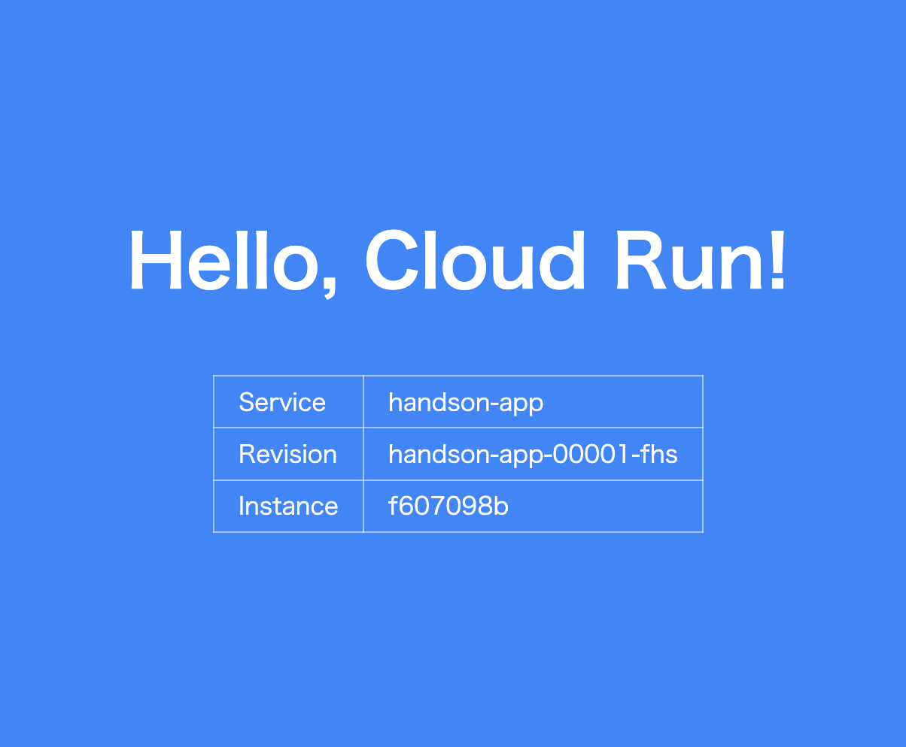
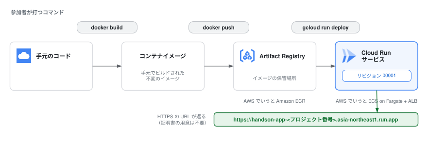

# 5. Cloud Runへデプロイする

ここからはGoogle CloudとCloud Runを本格的に触っていきます。  
4章で作ったイメージを Artifact Registry に push し、Cloud Run にデプロイして、世界中からアクセスできる HTTPS URL を手に入れます。

## 1. 環境変数の準備

この先の章でも使うので、まとめて設定しておきます(Cloud Shell が切断された場合はここから再実行してください)。

```bash
export PROJECT_ID=$(gcloud config get-value project)
export REGION=asia-northeast1   # 東京リージョン
export REPO=handson
export IMAGE=${REGION}-docker.pkg.dev/${PROJECT_ID}/${REPO}/app
```

#### 成功していれば
`echo ${IMAGE}` で `asia-northeast1-docker.pkg.dev/<プロジェクトID>/handson/app` の形が表示されます。  

#### 詰まったら
`asia-northeast1-docker.pkg.dev//handson/app` のようにプロジェクトIDの部分が抜けている場合は、`gcloud` にプロジェクトが設定されていません。  

以下を実行してから、この節のコードブロックを再実行してください。
```bash
gcloud config get-value project
gcloud config set project <プロジェクトID>
```

もしくはAPIの有効化を忘れている可能性があります。
```bash
gcloud services enable \
  run.googleapis.com \
  artifactregistry.googleapis.com \
  cloudbuild.googleapis.com
```

それでもダメ場合はログインをし直すことで解決できるパターンがあります。
```bash
gcloud auth login 
```

## 2. Artifact Registry にリポジトリを作る

Artifact RegistryはDocker HubやECR と同じく、Google Cloudのコンテナレジストリのマネージドサービスです。  
今回はArtifact Registryを使用してコンテナイメージを管理します。

以下のコマンドでコンテナイメージ用のリポジトリを作成します。
```bash
gcloud artifacts repositories create ${REPO} \
  --repository-format=docker \
  --location=${REGION} \
  --description="Cloud Run handson"
```

docker コマンドが Artifact Registry に push できるよう、認証ヘルパーを設定します。  

```bash
gcloud auth configure-docker ${REGION}-docker.pkg.dev
```

> Tips:  
> ECR の `aws ecr get-login-password` に相当します。  
> こちらは一度設定すれば、push のたびにトークンを取り直す必要はありません。

## 3. イメージにタグを付けて push する

Artifact Registry のイメージパスは `リージョン-docker.pkg.dev/プロジェクト/リポジトリ/イメージ名:タグ` という形式です。  

```bash
docker tag handson-app:v1 ${IMAGE}:v1
docker push ${IMAGE}:v1
```

初回の push はイメージ全体を転送するため、目安として数十秒から1分ほどかかります。  
push できたか確認してください。

```bash
gcloud artifacts docker images list ${REGION}-docker.pkg.dev/${PROJECT_ID}/${REPO} --include-tags
```

[コンソールの Artifact Registry](https://console.cloud.google.com/artifacts) からも見えます。

 成功していれば `gcloud artifacts docker images list` の出力に `.../handson/app` の行が1つ表示され、`TAGS` 列が `v1` になっています。  

## 4. Cloud Run にデプロイする

いよいよ本番です。  
**このコマンド1つで、ECS なら ALB・ターゲットグループ・ACM 証明書・サービス・タスク定義を組み立てていた作業がすべて終わります**(1章の発展コラムで触れた ECS Express Mode を除く)。

```bash
gcloud run deploy handson-app \
  --image ${IMAGE}:v1 \
  --region ${REGION} \
  --allow-unauthenticated

# 成功した場合、最後の行にURLが発行されます。
# Service URL: https://handson-app-123456.asia-northeast1.run.app
```

- `handson-app` が Service 名になります
- `--allow-unauthenticated` は「認証なしで公開」。
  - デフォルトは IAM 認証必須(=閉じている)で、AWS と逆のデフォルトです

30秒ほどで完了し、`Service URL: https://handson-app-<プロジェクト番号>.asia-northeast1.run.app` のような URL が表示されます。

## 5. アクセスして確認する

表示された URL をブラウザで開いてください。  
**4章で Cloud Shell の中で見たのと同じ青い画面が、今度は本物のインターネット越しに表示されます。**



### Cloud Shell エディタでのプレビューとの違い

- `Service` が `handson-app` に、`Revision` が `handson-app-00001-xxx` になっている
  - Cloud Run が注入する環境変数 `K_SERVICE` / `K_REVISION` をアプリが表示している
- URL が最初から **HTTPS**。証明書の発行も更新も何もしていない

コンソールの [Cloud Run のページ](https://console.cloud.google.com/run) も開いてみてください。  
Service の一覧、リビジョン、メトリクス、ログがすべて1画面に集約されています。

## 6. 「したこと」と「しなかったこと」

ここまでで「したこと」はリポジトリ作成 → push → deploy の3コマンドです。  
それより「**しなかったこと**」に注目してください。

- VPC・サブネット・セキュリティグループを作らなかった
- ロードバランサーもリスナーも作らなかった
- TLS 証明書を発行しなかった
- タスク定義(CPU/メモリ/ポート)を書かなかった
- キャパシティ(台数)を決めなかった
- タスク実行ロール・タスクロールを分けて作らなかった ※Service には既定のサービスアカウント(Compute Engine のデフォルトサービスアカウント)が1つ付くだけ(1章の対比)

最後の1つは確認できます。  
`gcloud run services describe handson-app --region ${REGION} --format 'value(spec.template.spec.serviceAccountName)'` を実行すると、`<プロジェクト番号>-compute@developer.gserviceaccount.com` の形のサービスアカウントが1つだけ表示されます(コンソールでは Service の詳細画面の「セキュリティ」タブで同じものが見えます)。

1章で話した「ビルディングブロック vs SaaS的アプローチ」が、これで体感できたはずです。

## まとめ


- Artifact Registryにコンテナイメージを保管した。
- Artifact RegistryのコンテナイメージからCloud Runを実行した。
- Cloud Run Serviceに実際にデプロイし、アクセスした。
