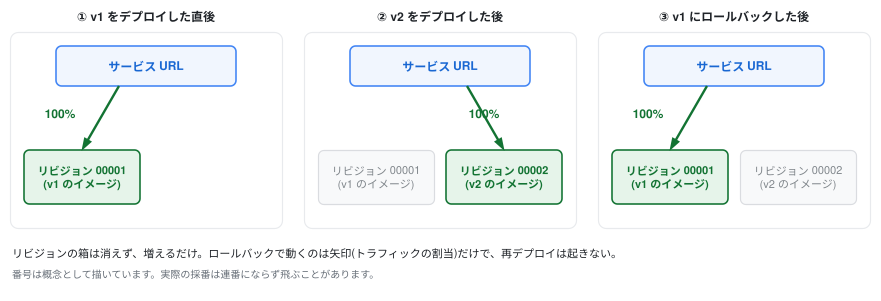

# 6. 更新とロールバック

アプリを変更して2回目のデプロイを行い、「リビジョン」がどう積み重なるかを見ます。  
その後、 **本番障害を想定してロールバック** を体験します。

## 1. アプリを変更する (v2)

`src/index.ts` の上部にある2行の既定値(`||` の右側)を書き換えます。

```typescript
const MESSAGE = process.env.MESSAGE || "Hello, Cloud Run v2!";
const BG_COLOR = process.env.BG_COLOR || "#EA4335"; // 赤
```

`MESSAGE` と `BG_COLOR` は環境変数から読み、設定されていなければこの既定値を使います。  
後述しますが、環境変数として外から渡すことも可能です。

## 2. build して push して deploy

前章でやったことの繰り返しです。  
タグは `v2` に変更する点に気をつけてください。

```bash
docker build -t ${IMAGE}:v2 .
docker push ${IMAGE}:v2

gcloud run deploy handson-app \
  --image ${IMAGE}:v2 \
  --region ${REGION}
```

> 2回目以降は `--allow-unauthenticated` などの設定を繰り返す必要はありません。  
> Service の設定は維持され、**変更したもの(イメージ)だけが新しいリビジョンとして記録されます**。

ブラウザをリロードしてください。  
**画面が赤くなり、Revision が `handson-app-00002-xxx` に変わっていれば成功です。**  
また、ダウンタイムなしで切り替わったことにも注目してください。

### 環境変数
#### コマンドから環境変数を設定する

`gcloud run deploy` に `--update-env-vars` を付けると、デプロイと同時に環境変数を設定できます。

```bash
gcloud run deploy handson-app \
  --image ${IMAGE}:v2 \
  --region ${REGION} \
  --update-env-vars '^@^MESSAGE=Hello from env!@BG_COLOR=#FBBC04'
```

- `--update-env-vars` は指定した変数だけを追加・上書きし、ほかの環境変数はそのまま残します
- 似たフラグの `--set-env-vars` は、既存の環境変数をすべて消してから設定します
- 先頭の `^@^` は、変数どうしの区切り文字をカンマから `@` に変える指定です
  - gcloud は値をカンマで区切って読むため、`Hello, Cloud Run!` のようにカンマを含む値はそのままだと途中で分かれ、`Bad syntax for dict arg` のエラーになります
  - 区切り文字には、どの値にも出てこない文字を選びます(値に `@` が入るなら `^:^` などにする)
- 引数全体をシングルクォートで囲むのは、`#`・`!`・空白をシェルに解釈させず、そのまま gcloud に渡すためです

カンマを含む値を設定する例です。

```bash
gcloud run deploy handson-app \
  --image ${IMAGE}:v2 \
  --region ${REGION} \
  --update-env-vars '^@^MESSAGE=Hello, Cloud Run!@BG_COLOR=#FBBC04'
```

デプロイが終わったらブラウザをリロードしてください。  
画面が黄色になり、Revision も新しい名前に変わります。  
**環境変数の変更も設定の変更なので、新しいリビジョンが作られます** (リビジョン = イメージ + 設定のスナップショット)。

#### コンソールからから環境変数を設定する
コンソールからも環境変数の設定が可能です。

1. [Cloud Run](https://console.cloud.google.com/run) の「サービス」から `handson-app` を選び、「新しいリビジョンの編集とデプロイ」をクリック
2. 「コンテナ」タブの「変数とシークレット」で、環境変数を追加
    - 名前 `MESSAGE` / 値 `Hello from env!`
    - 名前 `BG_COLOR` / 値 `#FBBC04`(黄)
3. 「デプロイ」をクリック

## 3. リビジョンの一覧を見る

```bash
gcloud run revisions list --service handson-app --region ${REGION}
```

`00001`(青/v1)と `00002`(赤/v2)の両方が残っています。  
リビジョンは **イメージ+環境変数+リソース設定を固めた不変のスナップショット** で、デプロイのたびに積み重なっていきます。

> **AWSとの比較**  
> ECS のタスク定義リビジョンに似ていますが、Cloud Run のリビジョンは「どこにトラフィックを流すか」の制御と一体化している点が違います。タスク定義+ALB加重ルーティング+デプロイ履歴が1つの概念になっているイメージです。

## 4. ロールバックする



ここで想定シナリオ: **「v2 をリリースしたらバグ報告が来た!すぐ戻したい!」**

AWS ならどうしますか?  
前のタスク定義を指定してサービス更新、デプロイが走るのを待ち、数分かかります。  
Cloud Run では、**すでに存在する v1 のリビジョンにトラフィックを振り向けるだけ**です。  
新しいデプロイは走りません。

<!--
> **[要作図] 図4: ロールバックはトラフィックの向きを変えるだけ**
>
> - **目的:** 「リビジョンは不変で、動くのはトラフィックだけ」を理解させる。この章の核心
> - **描き方:** 横に3コマ並べた時系列。各コマに「サービスURL」が1つあり、そこから下のリビジョン群へ矢印が伸びる構図にする
>   1. v1 デプロイ直後 — リビジョン 00001 のみ、矢印 100%
>   2. v2 デプロイ後 — 00001 と 00002 が**両方存在**し、矢印は 00002 へ 100%
>   3. ロールバック後 — リビジョンは2つのまま、矢印だけ 00001 へ戻る
> - **要点:** 3コマを通じて**リビジョンの箱は消えず増えるだけ**であることを見せる。動くのは矢印だけ。ここが AWS のローリングデプロイとの決定的な違い
> - **注意:** 番号は `00001` / `00002` と書いてよいですが、実際の採番は連番にならず飛ぶことがあります(この章の「2. ビルドして push して deploy」と7章の「2. トラフィックを流さずにデプロイする」で触れています)。図では概念として扱ってください
> - **完成後の扱い:** `06_revision/imgs/rollback-traffic-switch.svg` として保存し、**見出しの直下**に `` として差し込む(見出し → 画像 → 本文の順。キャプション文は付けない)
> - **現在の状態:** 上に差し込まれているのは draw.io で作図した完成図です。SVG に編集元の XML を埋め込んであるため、**このファイルをそのまま draw.io で開いて編集できます**
-->

### v1 のリビジョン名を確認

```bash
gcloud run revisions list --service handson-app --region ${REGION}

# REVISION: handson-app-00002-c58
#  :
# REVISION: handson-app-00001-fhs
```

トラフィックをv1に100%戻します。  
`handson-app-00001-<xxx>` のsuffix部分はランダムなので、自分のlistコマンドのREVISION名に書き換えてください。

```bash
export REV=handson-app-00001-<xxx>
gcloud run services update-traffic handson-app \
  --region ${REGION} \
  --to-revisions ${REV}=100
```

数秒待ってからブラウザをリロードしてください。 **青(v1)に戻ります。**  
トラフィックの切り替えは瞬時ではないため、まだ赤のままなら少し待って再読み込みしてください。

コンソールでも同じことができます: [Cloud Run](https://console.cloud.google.com/run) → サービス → 「リビジョン」タブ → 対象リビジョンの右側にある省略記号アイコンから「トラフィックを管理」。  
障害対応の現場では GUI でポチッと戻せるのは心強いです。

### v2 に戻す

ロールバック体験が終わったので、最新リビジョン(v2)に戻しておきます。

```bash
gcloud run services update-traffic handson-app \
  --region ${REGION} \
  --to-latest
```

`--to-latest` で最新のリビジョンに切り替えることができます。  
ブラウザで赤(v2)に戻ったことを確認してください。

## まとめ

- デプロイのたびに不変のリビジョンが積み重なる
- ロールバック = 過去リビジョンへのトラフィック切り替え。**再デプロイ不要、数秒で完了**
- 「イメージの不変性」がプラットフォーム機能として活きている
