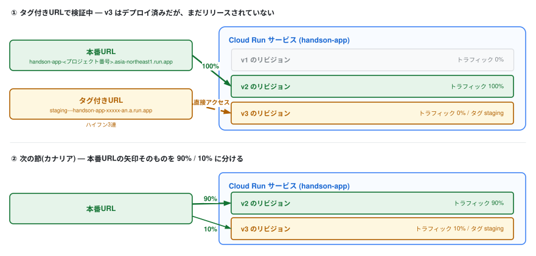

# 7. カナリアリリースとタグ付きURL

前章のトラフィック制御を一歩進めて、**新バージョンを10%のユーザーにだけ出すカナリアリリース**と、**トラフィックを流さずに本番環境で動作確認できるタグ付きURL**を体験します。

> **AWSとの比較**  
> これを ECS でやるには CodeDeploy のブルー/グリーン+ALB の加重ターゲットグループの設定が必要でした(検証用リスナーは任意ですが、リリース前検証をしたいなら実質必要になります)。Cloud Run では **Service に元から組み込まれた機能**です。

## 1. v3 を作る

今回はイメージを作り直さず、6章のTipsで試した環境変数でメッセージと背景を変えたものを v3 とします。  
イメージは v2 のまま、`MESSAGE` を `Hello, Cloud Run v3`、`BG_COLOR` を緑(`#34A853`)にします。  
デプロイは次の「2. トラフィックを流さずにデプロイする」でまとめて行います。

## 2. トラフィックを流さずにデプロイする



`--no-traffic` を付けてデプロイすると、リビジョンは作られますが**ユーザーへのトラフィックは1%も流れません**。  
さらに `--tag` を付けると、そのリビジョン専用のURLが発行されます。

```bash
gcloud run deploy handson-app \
  --image ${IMAGE}:v2 \
  --region ${REGION} \
  --no-traffic \
  --tag staging \
  --update-env-vars '^@^MESSAGE=Hello, Cloud Run v3@BG_COLOR=#34A853'
```

出力の最後に、このリビジョン専用のタグ付きURLが表示されます(`--no-traffic` のときは `Service URL:` の行は出ません)。  
本番URLは5章で取得したものと同じです。

- 本番URL: `https://handson-app-<プロジェクト番号>.asia-northeast1.run.app` → **まだ赤(v2)のまま**
- タグ付きURL: `https://staging---handson-app-xxxxx-an.a.run.app` → **緑(v3)**

両方をブラウザで開いて確認してください。  
**本番と同じ環境・同じ設定で、リリース前のバージョンだけを検証できるURL**が手に入りました。  
ステージング環境を別に組む代わりに、本番 Service の中に検証チャネルを持てるということです。

#### 成功していれば
出力に `serving 0 percent of traffic` と `The revision can be reached directly at https://staging---...` の2点が出ます。  
タグ付きURLは緑(v3)、本番URLは赤(v2)のままです。URLを見失ったら `gcloud run services describe handson-app --region ${REGION}` の出力で本番URLとタグ付きURLの両方を確認できます。  
なお**リビジョン名の番号は 00003 にならないことがあります**。番号の採番はデプロイ回数と一致せず、`handson-app-00005-xxx` のように飛ぶことがあります(リビジョンを見分けるのは末尾のランダム文字列です)。番号が飛んでいても失敗ではありません。

<!--
> **[要作図] 図5: デプロイとリリースの分離**
>
> - **目的:** 「1つの Service の中に本番チャネルと検証チャネルが同居する」構造を見せる。ステージング環境を別に建てる発想との違いが要点
> - **描き方:** 1つの「Cloud Run サービス」の箱の中にリビジョン3つ(v1 / v2 / v3)を並べ、箱の外から**2種類のURLが別々の矢印で入ってくる**形にする
>   - 本番URL(`handson-app-...run.app`)→ v2 へ 100%
>   - タグ付きURL(`staging---handson-app-...run.app`)→ v3 へ(トラフィック割当は 0%)
> - **要点:** v3 は「デプロイ済みだがリリースされていない」状態にあること。**デプロイ(コードを載せる)とリリース(ユーザーに出す)が別の操作**であることを図で言い切る
> - **続きのコマ(任意):** カナリア時に本番URLからの矢印が 90% / 10% に分かれる図を並べると、次の節にそのままつながる
> - **完成後の扱い:** `07_traffic/imgs/deploy-release-separation.svg` として保存し、**見出しの直下**に `` として差し込む(見出し → 画像 → 本文の順。キャプション文は付けない)
> - **現在の状態:** 上に差し込まれているのは draw.io で作図した完成図です。SVG に編集元の XML を埋め込んであるため、**このファイルをそのまま draw.io で開いて編集できます**
-->

## 3. 10%だけ流す(カナリアリリース)

v3 の動作確認が取れた想定で、まず10%のユーザーにだけ出します。

```bash
gcloud run services update-traffic handson-app \
  --region ${REGION} \
  --to-tags staging=10
```

確認してください。  
`/api` エンドポイントを20回叩いて、どのリビジョンが応答したかを集計します。

```bash
URL=$(gcloud run services describe handson-app --region ${REGION} --format 'value(status.url)')

for i in $(seq 1 20); do curl -s ${URL}/api | jq -r .revision; done | sort | uniq -c
```

リビジョン名が2種類表示され、`18 handson-app-00002-vjk` のように v2 のリビジョンが18回・v3 のリビジョンが2回、という比率になるはずです。  
ブラウザを何度もリロードして「たまに緑が出る」のを見るのも楽しいです。

> 実務ではこの状態でエラーレートやレイテンシのメトリクス(9章)を監視し、問題なければ段階的に割合を増やしていきます。

#### 成功していれば
`gcloud run services describe handson-app --region ${REGION}` の Traffic 欄が `90% handson-app-00002-xxx` と `10% handson-app-000xx-xxx`(その下に `staging: https://staging---...` が付きます)に分かれ、20回の集計でも v3 のリビジョン名が数回混ざります。  
10%の乱数なので v3 のリビジョン名が0回や4回になることもあり、比率が多少ずれても失敗ではありません。

## 4. 100%に昇格する

```bash
gcloud run services update-traffic handson-app \
  --region ${REGION} \
  --to-latest
```

> `--to-latest` は「いま動いているリビジョンに固定する」という意味ではなく、**`LATEST`(=最新リビジョン)に100%割り当てる**という設定です。  
> そのため、この状態で次のデプロイを行うと、新しく作られたリビジョンがそのまま `LATEST` になってトラフィックを受け取ります(5〜6章で体験した普通のデプロイ挙動に戻る、ということです)。

ブラウザで全リロードが緑(v3)になれば完了です。  
もし v3 に問題が見つかっていたら?——前章でやった通り、v2 に一瞬で戻せます。

#### 成功していれば
Traffic 欄に `100% LATEST (currently handson-app-000xx-xxx)` が現れ、上の for ループを再実行すると20回すべて v3 のリビジョン名になります。  
`staging` タグ自体は残るので、Traffic 欄には `0% (currently -) handson-app-000xx-xxx` と `staging (Adding):` / `staging (Deleting): https://staging---...` という行も並びます。  
**これは表示上の見え方で、トラフィックは 100% 最新リビジョンに向いています**(for ループの結果が20回すべて同じ v3 のリビジョン名ならそれが答えです)。

## まとめ

- `--no-traffic` + `--tag` で「デプロイ」と「リリース」を分離できる
- タグ付きURLで、本番環境そのものを使ったリリース前検証ができる
- カナリア → 段階的昇格 → 即ロールバック、が追加インフラなしで完結する

**デプロイのたびに緊張するチームほど、この機能の価値は大きい**はずです。
